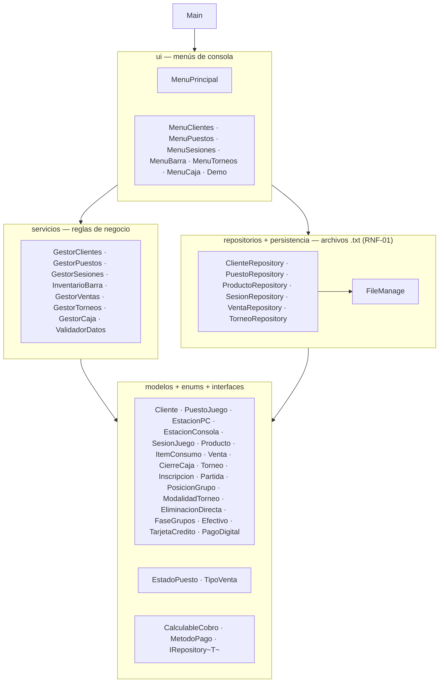
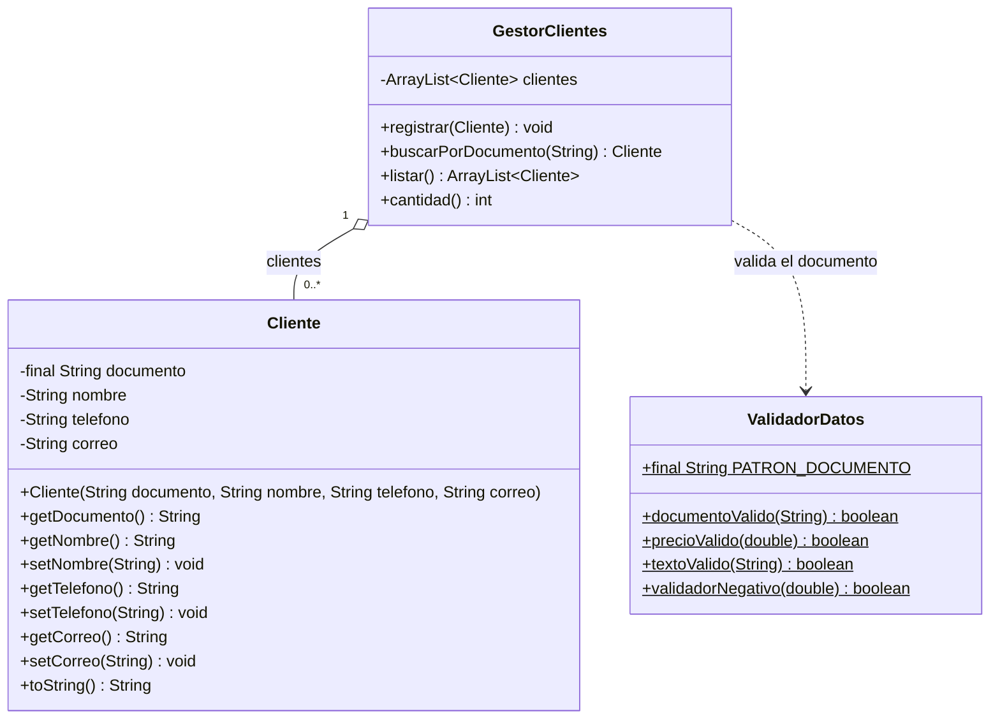
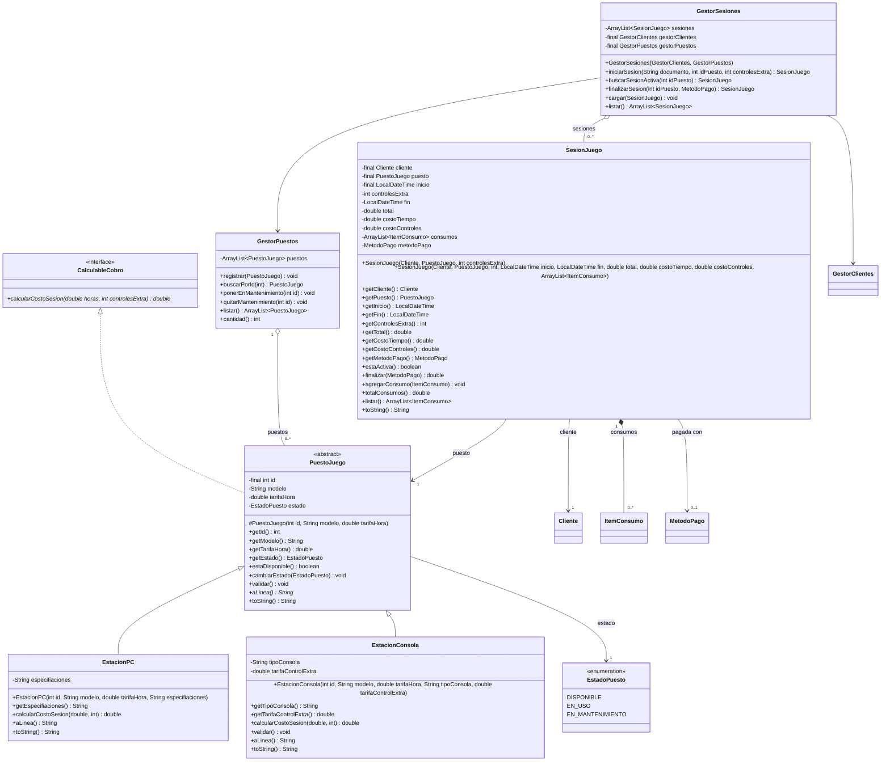
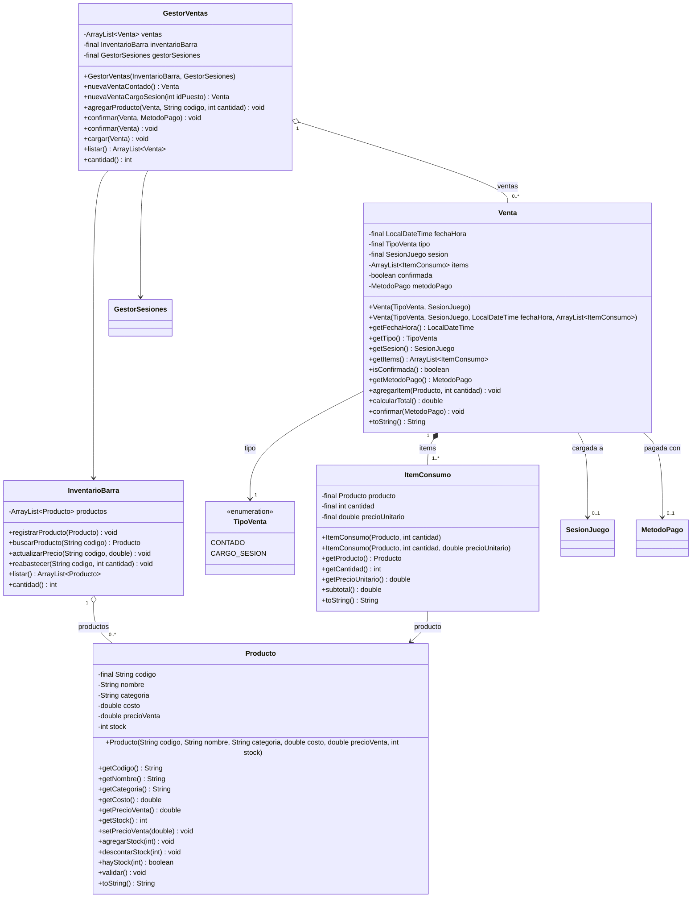
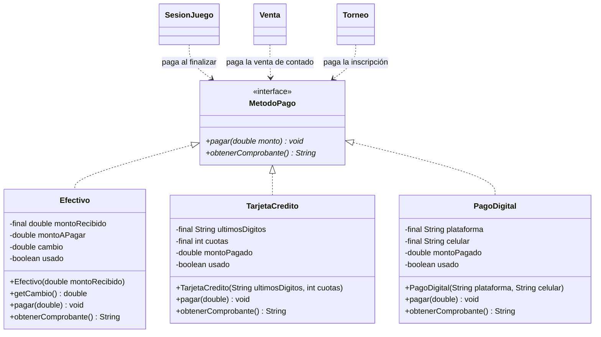
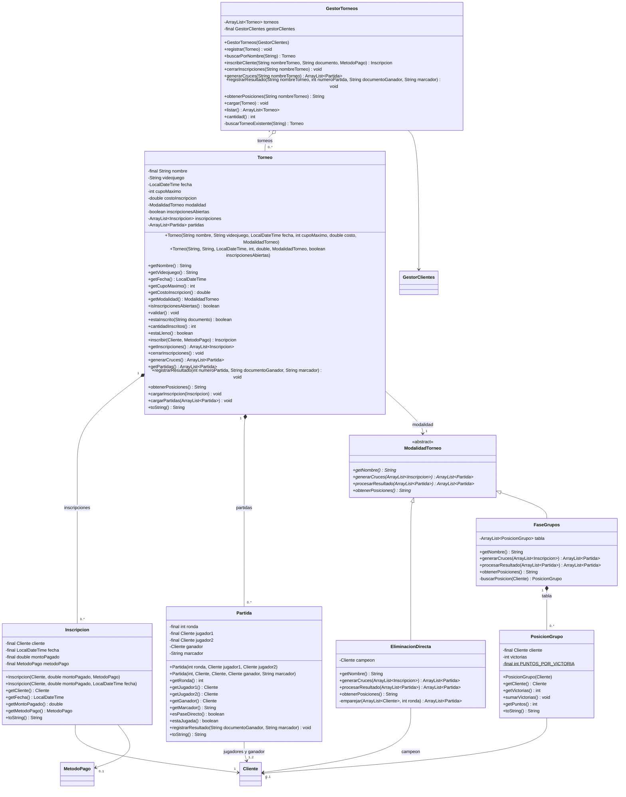
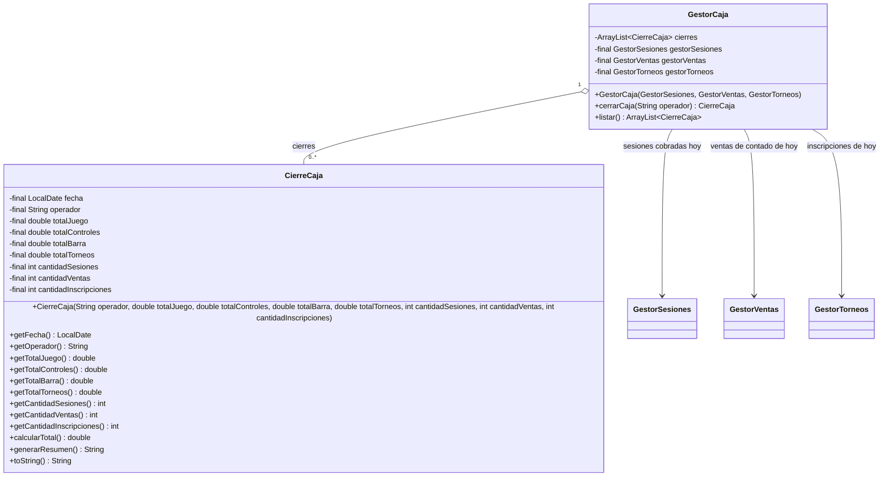
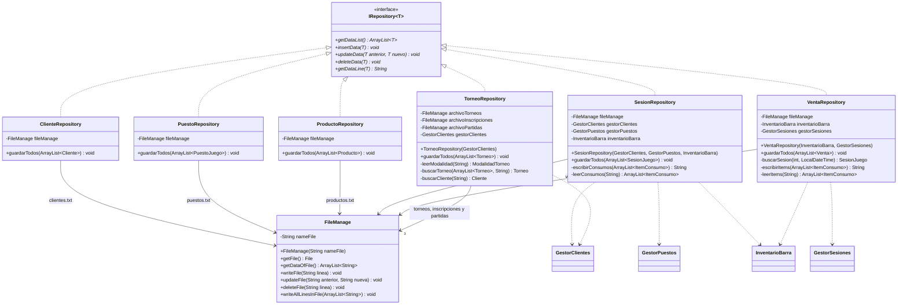
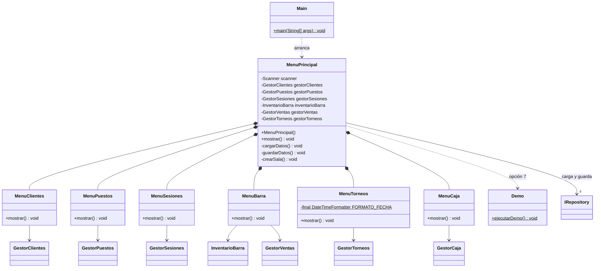

# GG Hub — Diagrama de clases (versión final)

Diagrama sacado directamente del código final (`GGHUB/src`). Reemplaza al diagrama de la Entrega 2; los cambios respecto a ese diseño están explicados en el [README](../README.md#cambios-respecto-al-diseño-de-la-entrega-2).

Para que se pueda leer, está dividido por áreas. Cuando una clase de otra área aparece como una caja vacía, es solo una referencia: su detalle está en su propia sección.

**Notación**

| Símbolo | Significado |
| :--- | :--- |
| `+` / `-` / `#` | público / privado / protegido |
| `final` | se asigna una sola vez (identificadores y hechos ya ocurridos) |
| subrayado | miembro estático (`static`) |
| cursiva | método abstracto |
| `<<abstract>>` / `<<interface>>` / `<<enumeration>>` | clase abstracta / interfaz / enum |
| flecha con triángulo vacío, línea continua | herencia (`extends`) |
| flecha con triángulo vacío, línea punteada | implementa una interfaz (`implements`) |
| rombo relleno | composición: la parte no existe sin el todo |
| rombo vacío | agregación: el gestor guarda la lista |
| flecha simple | asociación: tiene una referencia a |
| flecha punteada | dependencia: lo usa |

---

## 1. Vista general por capas

El menú principal crea los gestores **una sola vez**; los gestores que necesitan otros los reciben **por constructor** (el mismo objeto), y los repositorios cargan los datos al arrancar y los guardan al volver de cada submenú.

---

## 2. Clientes y validación (RF-01)

- El `documento` es la identidad del cliente: es `final` y no tiene setter.
- `registrar` rechaza documentos que no sean solo dígitos y documentos repetidos. `listar` devuelve una copia de la lista.
- `ValidadorDatos` solo tiene miembros estáticos: se usa desde todo el sistema sin crear objetos.

---

## 3. Estaciones, sesiones y cobro (RF-02 a RF-05)

- **Herencia y abstracción:** no existe "un puesto" a secas; `PuestoJuego` es abstracta y su constructor es `protected` (solo lo llaman las hijas con `super`). Los ids son compartidos entre PC y consola (PCs 1–15, consolas 16–25).
- **Polimorfismo:** `PuestoJuego` implementa `CalculableCobro` pero deja `calcularCostoSesion` a las hijas: el PC cobra horas × tarifa y la consola suma los controles extra. `validar()` (la consola revisa además su tarifa por control) y `aLinea()` (la línea que se guarda en el archivo) también se sobreescriben.
- **Estado:** `EN_USO` lo pone `iniciarSesion`; `DISPONIBLE` lo pone la propia sesión al cobrarse en `finalizar(metodo)`; el mantenimiento entra solo por `GestorPuestos`.
- **Cobro:** `finalizar` calcula el tiempo (por minutos), separa `costoTiempo` y `costoControles`, suma los consumos, **cobra** con el método de pago y solo si el pago sale bien cierra la sesión. El segundo constructor se usa para cargar sesiones guardadas.

---

## 4. Barra y ventas (RF-06 y RF-07)

- El `codigo` del producto es su identidad (`final`). El stock solo cambia con movimientos que validan: `agregarStock` (mayor a cero) y `descontarStock` (no deja vender más de lo que hay). No existe `setStock`.
- `ItemConsumo` **copia el precio** del producto en el momento de la venta: si el precio cambia después, las ventas pasadas no se alteran.
- `Venta.confirmar` es **atómica**: valida todo (productos, sesión abierta, stock), cobra si es de contado, y solo después descuenta el stock y, si es `CARGO_SESION`, agrega los items a los consumos de la sesión (se pagan al finalizarla).
- `GestorVentas.confirmar` tiene **sobrecarga**: con método de pago (contado) y sin él (cargo a sesión).

---

## 5. Pagos

- **Polimorfismo:** la sesión, la venta y el torneo solo llaman `metodo.pagar(total)`, sin saber cuál es. El efectivo rechaza si no alcanza y calcula el cambio; la tarjeta exige 4 dígitos y de 1 a 36 cuotas; el pago digital exige plataforma y un celular de 10 dígitos.
- `pagar` lanza una excepción si el pago no se puede hacer (no devuelve `boolean`), así cada forma de pago explica su motivo.
- Cada objeto de pago se usa **una sola vez** (`usado`): un segundo `pagar` lanza error.

---

## 6. Torneos (RF-08 a RF-11)

- El torneo se identifica por su `nombre` (`final`). `validar` exige nombre, videojuego, modalidad, fecha no anterior a la actual, cupo de al menos 2 y costo mayor a cero.
- `inscribir` valida que estén abiertas, que no esté repetido y que haya cupo; **después cobra** con el método de pago y solo entonces crea la inscripción. `Inscripcion` guarda el `montoPagado` (lo usa el cierre de caja).
- **Polimorfismo:** el torneo le pide a su modalidad que genere los cruces, procese los resultados y muestre las posiciones, sin preguntar cuál es. Eliminación directa empareja de a dos (si son impares, uno pasa directo) y arma la siguiente ronda con los ganadores hasta que queda el campeón. Fase de grupos es todos contra todos y recalcula la tabla desde cero con cada resultado (3 puntos por victoria, sin empates).
- Los segundos constructores de `Torneo`, `Inscripcion` y `Partida`, y `cargarInscripcion` / `cargarPartidas`, se usan para recuperar los torneos guardados sin volver a validar fechas pasadas ni a cobrar.

---

## 7. Cierre de caja (RF-12)

- `cerrarCaja` divide el dinero del día en los cuatro rubros del RF-12: **tiempo de juego** y **controles extra** (de las sesiones cobradas hoy), **barra** (ventas de contado más los consumos cargados a sesiones) e **inscripciones a torneos**.
- Las ventas con cargo a sesión no se suman aparte: ya vienen dentro de los consumos de su sesión, así nada se cuenta dos veces.
- `CierreCaja` es un registro de algo que ya pasó: todos sus atributos son `final`, la fecha la pone sola y el operador es su nombre (texto).

---

## 8. Persistencia (RNF-01)

- Cada repositorio implementa los cinco métodos de `IRepository<T>` (`getDataList`, `insertData`, `updateData`, `deleteData`, `getDataLine`) para su entidad; en el diagrama solo se muestran los métodos propios de cada uno.
- `FileManage` escribe y lee los `.txt` de `src/files/` (crea la carpeta si no existe). Los campos van separados por `|`.
- Los objetos que contienen a otros se guardan por su identificador (documento, id de estación, código de producto) y al cargar se buscan en el gestor correspondiente; por eso algunos repositorios reciben gestores.
- `PuestoRepository` guarda cada estación con `aLinea()` (polimórfico: cada tipo arma su propia línea).

---

## 9. Interfaz de consola

- Los menús **no tienen reglas de negocio**: piden los datos, llaman al gestor y muestran el mensaje de la excepción si algo se rechaza. Todos comparten el mismo `Scanner`.
- `MenuPrincipal` crea los gestores una sola vez, carga los archivos al arrancar y guarda todo cada vez que se vuelve de un submenú. Tiene además un atributo por cada repositorio (los seis de la sección 8).
- Los métodos privados de cada menú (una opción por método, más `leerEntero`, `leerDouble` y `seleccionarMetodoPago`) no se muestran.
- `Demo` ejecuta las pruebas de todos los requerimientos con sus propios gestores, sin tocar los datos guardados.
